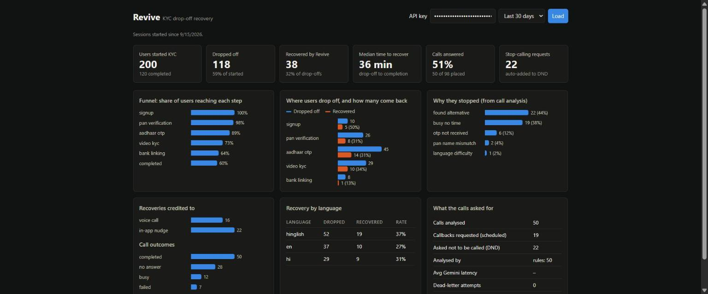
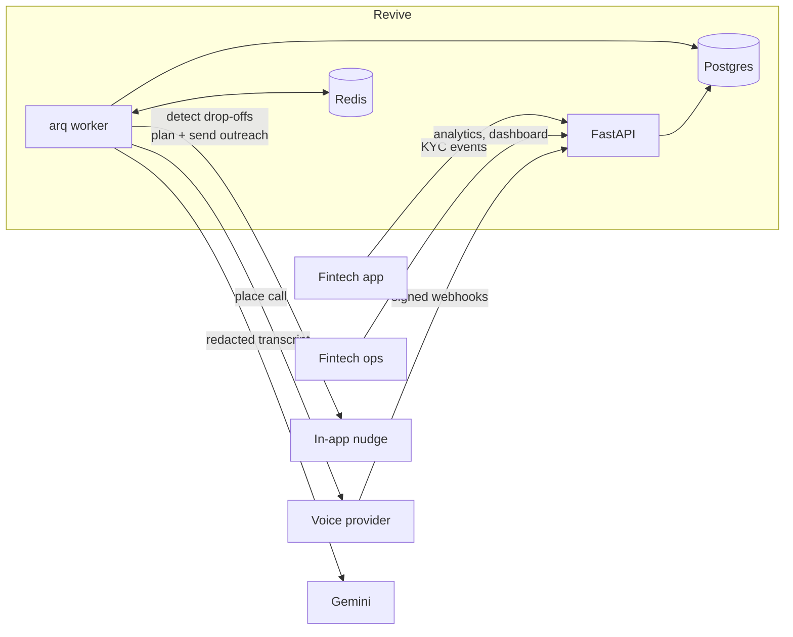

# Revive

[](https://github.com/ShivamPratap16/revive/actions/workflows/ci.yml)

**A backend that wins back users who abandon KYC halfway through a fintech app.**

A user starts onboarding on a lending or broking app, gets stuck at the Aadhaar OTP, and closes it.
Revive notices, nudges them in the app, calls them with a voice agent, reads the conversation with
Gemini, and acts on it: *"shaam ko 6 baje ke baad karo"* becomes a 6pm call, and
*"please mujhe dobara call mat karna"* puts the number on the do-not-disturb list.

Python 3.13 · FastAPI · async SQLAlchemy 2.0 · PostgreSQL · Redis · arq · Gemini · Docker · GitHub Actions

### Live demo: [revive-h920.onrender.com/dashboard](https://revive-h920.onrender.com/dashboard)

Demo API key: `rv_live_5fubuSFUQFHEsbTEKXHgVzzoYH9eACRhYnZcBtc9_zo`. Paste it on the dashboard, or click **Authorize** on the
[interactive API docs](https://revive-h920.onrender.com/docs). It only reaches the demo tenant.
*Free hosting: the first request after a quiet spell takes about a minute while the server wakes up.*

**Try the whole pipeline yourself.** Report a user stuck on Aadhaar OTP; within about 2 minutes they get a nudge
and a voice call, and Gemini's analysis appears under `GET /v1/calls`:

```bash
curl -X POST https://revive-h920.onrender.com/v1/events \
  -H "X-API-Key: rv_live_5fubuSFUQFHEsbTEKXHgVzzoYH9eACRhYnZcBtc9_zo" -H "Content-Type: application/json" \
  -d '{"events":[{"event_id":"try-'$RANDOM'","session_id":"try-'$RANDOM'","type":"step_failed",
       "step":"aadhaar_otp","error_code":"OTP_NOT_RECEIVED",
       "occurred_at":"'$(date -u -d '-2 minutes' +%Y-%m-%dT%H:%M:%SZ)'",
       "user":{"id":"you","phone":"+919876543210","name":"Your Name","language":"hinglish"}}]}'
```



*Dashboard over 200 simulated users (`python -m app.demo`): 118 drop-offs, 38 recovered (32%), median 36 minutes from drop-off to completion.*

---

## What it does

| | |
|---|---|
| **1. Ingest** | The fintech's app reports KYC events in batches. Idempotent (retries are safe), ordered correctly even when events arrive late, safe under concurrent requests. |
| **2. Detect** | A worker finds users idle too long on a step (OTP: 15 min, video KYC: 45 min, configurable per fintech) and plans a follow-up in the same transaction. |
| **3. Reach out** | In-app nudge first, voice call 30 min later, another the next day. Respects TRAI calling hours, Sundays, DND, and a daily call cap, re-checked at the moment of sending. |
| **4. Call** | Places calls through a voice provider API. Receives HMAC-signed webhooks (ringing, answered, transcript ready), handling duplicates, reordering and races. Re-dials unanswered calls. |
| **5. Understand** | Redacts Aadhaar/PAN/phone/OTPs, asks Gemini for structured insight (why they stopped, what they want), verifies it, and acts: DND, scheduled callbacks. |
| **6. Measure** | Funnel, drop-offs and recovery by step, channel attribution, reasons from calls, language breakdown. API + dashboard. |

## Architecture



Postgres is the source of truth. Work that must not be lost (outreach attempts, call analyses) is
written to tables in the same transaction as the change that caused it (transactional outbox), then
claimed by workers with `FOR UPDATE SKIP LOCKED` and a lease. Redis only carries "do job X" messages
and the shared Gemini rate limit, so losing it loses no work.

## Results

**Call analysis, measured** (`python -m app.evals`, full results in [evals/RESULTS.md](evals/RESULTS.md)).
Conversations with known answers, scored on outcome, reason, do-not-call, callback time and language.
The held-out cases were written after the rules, in different words, including a prompt-injection attempt.

| Analyzer | Seen cases (all fields right) | Held-out cases (all fields right) |
|---|---|---|
| Rule-based fallback | 10/10 | 2/6 |
| Gemini (`gemini-3.5-flash-lite`), prompt v1 | 8/10 | 6/6 |
| **Gemini, prompt v2 + code decides language** (shipped) | **9/10** | **6/6** |

The rules scored 100% only on the conversations they were written against. That overfitting is why
Gemini is the primary analyzer and the rules are only the fallback.

**Correctness, proven by breaking it.** Concurrency tests were checked by removing the safeguard
and watching them fail:

| Safeguard removed | What happened |
|---|---|
| `SELECT … FOR UPDATE` on the session | 20 concurrent events → failure count **2** instead of 20 (18 lost updates) |
| Row lock in the drop-off detector | Two workers both processed all 10 users (20 instead of 10) |
| Row lock on the call during webhooks | Final status `ringing` although `completed` arrived (5/5 runs) |
| PII redaction before the LLM call | Raw phone number found in the outgoing Gemini request |

**148 tests**, run against real Postgres and Redis, including end-to-end runs where the provider
simulator and the API talk to each other in-process with 100% duplicated and reordered webhooks.

## Quick start

```bash
cp .env.example .env              # optional: add GEMINI_API_KEY=... (without it, rules are used)
docker compose up -d --build      # postgres, redis, migrations, api, worker, voice simulator

docker compose exec api python -m app.demo --users 200   # a month of demo data; prints an API key
# open http://localhost:8000/dashboard and paste the key
# API docs: http://localhost:8000/docs
```

Local development (Python 3.12+):

```bash
docker compose up -d postgres redis
python -m venv .venv && .venv\Scripts\activate          # source .venv/bin/activate on Linux/macOS
pip install -e ".[dev]"
alembic upgrade head
python -m app.cli create-tenant "Acme Finance"           # prints an API key
uvicorn app.main:app --reload --port 8077                # API
arq app.worker.WorkerSettings                            # worker
uvicorn simulator.main:app --port 8099                   # fake voice provider (set VOICE_API_URL)
pytest -q
```

## Deployment

`render.yaml` deploys Revive to Render's free plan with Neon as the database:

| Piece | Where |
|---|---|
| API + worker + voice simulator | one Render web service, Docker (`RUN_WORKER_IN_PROCESS`, `MOUNT_SIMULATOR`) |
| PostgreSQL | Neon free tier (doesn't expire) |
| Redis | Render Key Value free tier, no outside access |
| Secrets | `DATABASE_URL` and `GEMINI_API_KEY` entered in Render; voice key and webhook secret generated by Render |

`scripts/start.sh` runs migrations on every start (already-applied ones are skipped), then starts
uvicorn on `$PORT`. Neon's connection string is accepted as copied: `sslmode` and the pooler
host are converted for the async driver (`app/config.py`).

All-in-one mode is a free-hosting trade-off. The free web service sleeps after 15 minutes without
traffic, and the worker sleeps with it. Nothing is lost: due work stays in Postgres and runs when
the next request wakes the service. Production would run `arq app.worker.WorkerSettings` as its
own always-on service.

## API

| Endpoint | |
|---|---|
| `POST /v1/events` | Batch of KYC events. Idempotent per `event_id`. |
| `GET /v1/sessions`, `GET /v1/sessions/{id}` | Sessions with cursor pagination; detail with events and outreach. |
| `GET` / `PUT /v1/policy` | Per-tenant rules: idle limits, cadence, calling window, caps. |
| `POST /v1/dnd`, `DELETE /v1/dnd/{phone}` | Do-not-disturb list. |
| `GET /v1/outreach?status=dead`, `POST /v1/outreach/{id}/retry` | Attempts and the dead-letter queue. |
| `GET /v1/calls`, `GET /v1/calls/{id}` | Calls with transcript, webhook timeline and AI analysis. |
| `POST /webhooks/voice/{provider}` | Provider webhooks (HMAC-signed, no API key). |
| `GET /v1/analytics/summary?days=30` | Everything on the dashboard. |

Authentication: `X-API-Key` per tenant (stored as SHA-256). Every query is tenant-scoped.
Errors share one shape with a `request_id` that matches the JSON logs.

## Design decisions

- **Idempotency everywhere.** Client event ids, provider webhook ids, idempotency keys on outgoing
  calls (one per call placement, reused across retries so a timeout can't ring a user twice).
- **Pure domain functions, clock passed in.** The journey and call state machines, calling windows
  and pre-send checks are pure functions taking `now`, so time-based logic is tested deterministically.
- **No transaction across a network call.** Claim with a short transaction and a lease, call the
  provider with no transaction open, record with a conditional update.
- **Webhook security.** HMAC-SHA256 over timestamp + raw body, constant-time compare,
  5-minute replay window, secret rotation, then dedupe on the provider's event id.
- **LLM output is untrusted input.** JSON schema + Pydantic validation, the supporting quote must
  exist in the transcript, callback times must be sane, and "do not call" is honoured if the model
  *or* the rules hear it (wrongly calling costs more than one missed call).
- **Degrade, don't fail.** A Redis token-bucket rate limiter shared by all workers (Lua, atomic),
  daily quota, circuit breaker, retries with jittered backoff, rule-based fallback.
- **Use the model only where judgement is needed.** Spoken language is decided by script detection
  (16/16 in evals) rather than by the model, which varied between prompt versions.

## Project layout

```
app/
  api/            HTTP routes (events, sessions, outreach, calls + webhooks, analytics)
  domain/         pure logic: journey, policy, scheduling, call states, redaction, insights, messages
  services/       transactions and side effects: ingest, detector, delivery, calls, analysis, analytics
  llm/            Gemini client; rate limiter, quota, circuit breaker
  channels.py     push / voice delivery adapters (simulated and HTTP)
  worker.py       arq worker: cron jobs and delivery jobs
  evals.py        analyzer evaluation (seen vs held-out)
  demo.py         seeds realistic data through the real pipeline
simulator/        fake voice provider with realistic Hinglish/Hindi/English calls and chaos options
migrations/       Alembic
tests/            unit, integration and end-to-end tests
```

## Known limits

- Redaction is regex-based: written numbers are caught, spelled-out ones ("chaar aath do") are not.
- The circuit breaker is per worker process; a Redis-backed one would react faster across many workers.
- The voice provider and push channel are simulated; a real provider is one `DeliveryChannel` adapter.
- The eval set is small (16 conversations); a production system needs real, labelled calls.

---

Built by **Shivam Pratap Raj** · [GitHub](https://github.com/ShivamPratap16) · [LinkedIn](https://www.linkedin.com/in/shivam-pratap-raj-99280826b/)
